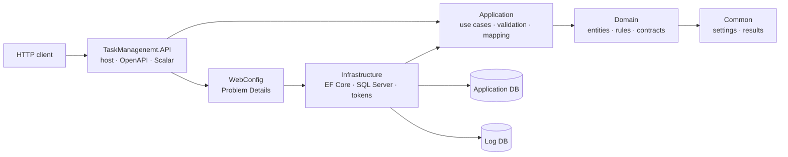
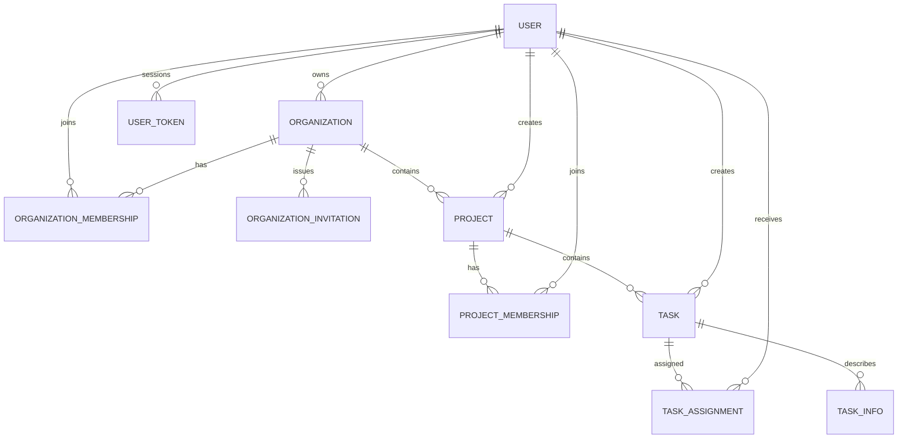

<p align="center">
  <a href="https://dotnet.microsoft.com/download/dotnet/10.0">
    
  </a>
  
  
  
  
</p>

<h1 align="center">TaskManagement API</h1>

<p align="center">
  A .NET 10 backend for collaborative work: users, organizations, projects, and tasks,<br>
  with explicit domain rules, MediatR use cases, and SQL Server persistence.
</p>

<p align="center">
  <a href="#quick-start">Quick start</a> ·
  <a href="#architecture">Architecture</a> ·
  <a href="#use-cases">Use cases</a> ·
  <a href="#configuration">Configuration</a> ·
  <a href="#current-scope">Current scope</a>
</p>

---

The application core is in place. Domain entities enforce their own rules, application use cases are dispatched through MediatR, and infrastructure persists two SQL Server databases. The host starts, publishes an OpenAPI document, and serves Scalar.

Controllers are not in the repository yet. `MapControllers()` is registered, and there is no controller class to map. Calling the host gives you the API reference, not a finished HTTP product.

## What it models

An organization has an owner, a capacity, members, and invitations. Projects live inside an organization and have their own members, progress, and lifecycle. Tasks belong to a project, can be assigned to more than one user, and can carry separate `TaskInfo` records. Each account can hold up to three active device sessions.

| | |
|---|---|
| **Runtime** | .NET 10, ASP.NET Core, C# with nullable reference types |
| **Application** | MediatR 14, FluentValidation 12, AutoMapper 16 |
| **Data** | EF Core 10, SQL Server, repository + unit of work |
| **API docs** | Built-in OpenAPI and [Scalar](https://scalar.com) 2.17 |
| **Identity** | Identity `PasswordHasher`, signed and encrypted access tokens, rotating refresh tokens |

Declared package versions live in the project files: EF Core and OpenAPI `10.0.12`, MediatR `14.2.0`, FluentValidation `12.2.0`, AutoMapper `16.2.0`, Scalar.AspNetCore `2.17.14`.

## Architecture

The solution is layered. References point inward from the host toward the domain, with two deliberate exceptions: Infrastructure references Application (so it can implement application ports), and WebConfig references Infrastructure (so the host can register persistence and exception handling in one place).



| Project | Owns |
|---|---|
| `TaskManagenemt.API` | Host composition, controller registration, OpenAPI, Scalar. The folder spelling `Managenemt` is the project name. |
| `TaskManagement.WebConfig` | Exception-to-Problem-Details mapping. |
| `TaskManagement.Application` | Commands, queries, handlers, validators, application services, AutoMapper profiles, pipeline behaviors. |
| `TaskManagement.Domain` | Entities, enums, domain services, repository contracts. No EF Core and no ASP.NET Core. |
| `TaskManagement.Infrastructure` | DbContexts, entity configurations, repositories, unit of work, JWT, password hashing, snowflake ids. |
| `TaskManagement.Common` | `AppSettings`, `GeneralResult`, small helpers. |

`Program.cs` stays a composition root:

- `RegisterAllApplicationLayerConfiguration()` — application services, domain services, AutoMapper, MediatR, FluentValidation
- `RegisterAllInfrastructureLayerConfiguration(configuration)` — both databases, repositories, unit of work, helper services, options
- `RegisterExceptionHandlersAndServices()` — Problem Details handlers
- `CompileAutoMapperConfiguration()` — compiles mappings and fails startup when a map is invalid

A request that has a handler moves through three MediatR behaviors, outer to inner: timing (`PerformanceBehavior`), validation (`ValidationBehavior`), then a transaction (`TransactionBehavior`). The transaction behavior runs only for a request that implements `ITransactionalCommand`. Today that is `CreateUserCommand` alone. The transaction covers `ApplicationDbContext`. The log database is a second connection and is not enlisted in it.

## Domain



| Entity | Role |
|---|---|
| `User` | Account: mobile number (the login id), email, password hash, security stamp, name, points, last login. |
| `UserToken` | One device session. Stores hashes, status, expiry, and the security stamp captured at issue. |
| `Organization` | Name, secondary name, owner, generated code, description, active flag, member capacity. |
| `OrganizationMemberShip` | User membership and organization role. |
| `OrganizationInvitation` | Invitation issued by an organization. Carries a row version. |
| `Project` | Organization project: creator, progress, status, capacity, start/end, row version. |
| `ProjectMemberShip` | User membership and project role. |
| `Task` | Work item: type, status, deadline, progress, active flag, row version. |
| `TaskAssignment` | Assignment of a user to a task. |
| `TaskInfo` | Extra information attached to a task. |
| `EntityLog` / `EntityRelationLog` | Action and relationship records in the log database. |

Application entities inherit `BaseEntity`: a `long` id, `IsDelete`, `CreatedAt`, `UpdatedAt`, `AssignId`, and `SoftDelete`. Configurations apply a global query filter named `IsDeleteFillter` so deleted rows stay out of normal queries. `Project`, `Task`, and `OrganizationInvitation` map `RowVersion` with `IsRowVersion()`. Deletes are restricted. Table names are pluralized.

### Rules that live in the domain

- An account can own at most **3** organizations.
- An account can have at most **3** active sessions (`TokenStatusType.Active`).
- Organization roles are `Owner`, `Admin`, and `Member`. Project roles are `Creator`, `Admin`, and `Member`.
- A project moves through `InProgress`, `Adjournment`, `Cancel`, and `Finished`. Lifecycle methods reject repeated or illegal transitions.
- A task moves through `InProgress`, `Cancel`, `Dead`, and `Finished`, and is either `Single` or `Group`.
- An invitation is `Pending`, `Accepted`, `Expired`, or `Revoked`.
- User-facing validation and domain messages are written in Persian.

### Identifiers

`IdGeneratorService` builds a 64-bit snowflake: 1 sign bit, 42-bit timestamp, 5-bit entity type, 3-bit worker, 10-bit sequence, 3-bit format version. The epoch is 2026-01-01. `IdGeneratorSetting:WorkerId` must be **0–7** and unique among nodes that share an id space. `EntityIdSaveChangesInterceptor` fills an id that is still `0` at save time. The repository assigns ids before that as well.

`NormalizeStringInterceptor`, registered only on the application context, normalizes Persian and Arabic character variants on changed strings before SQL is generated.

## Use cases

Each use case is a folder under `TaskManagement.Application/Features/{Area}/{Command|Query}/{Name}/`, with a request record, a handler, and a validator when the input has rules.

### Account and session

| Use case | Kind |
|---|---|
| `CreateUser`, `UpdateUser`, `DeleteUser`, `ChangePasswordUser` | Command |
| `IncreaseUserPoints`, `DecreaseUserPoints` | Command |
| `GetUserById`, `GetUserByMobileNumber` | Query |
| `LoginUser`, `LogoutUser`, `RefreshUserToken` | Command |
| `RevokeTokenByDeviceId`, `RevokeAllTokensByUserId`, `RevokeAllTokensExceptCurrentByUserId` | Command |
| `GetUserActiveTokens`, `ValidateAccessToken` | Query |

Passwords are hashed with ASP.NET Core Identity's `PasswordHasher` and checked with `VerifyHashedPassword`. Access tokens are HMAC-SHA256 signed and encrypted with AES-128 key wrap (`Aes128KW`, `Aes128CbcHmacSha256`). Refresh tokens are 64 random bytes, Base64-encoded. The device id is a claim and is checked on validation.

`Program.cs` calls `UseAuthorization()` and does not register an authentication scheme or `UseAuthentication()`. A token produced by `JwtService` does not, by itself, authorize a controller action.

Session lookup in `AuthService` hashes the presented token with `PasswordHasher` and compares that string to the stored hash. That hasher is salted, so a newly produced hash does not equal the stored one. Password verification is a separate path and uses the hasher's verify API.

### Organization, project, task

| Area | Commands | Queries |
|---|---|---|
| Organization | `CreateOrg`, `UpdateOrg`, `DeleteOrg`, `ChangeOrgActivity`, `AddUserToOrg`, `RemoveUserFromOrg`, `LeaveUserFromOrg`, `ChangeUserRoleToAdmin`, `ChangeUserRoleToMember` | `GetOrgById`, `GetOrgByCode` |
| Invitation | `GenerateInviteLinkByUserId`, `AcceptInvitation`, `RevokeInvitation` | `GetOrgInvitationById`, `GetPendingOrgInvitationById`, `GetAllOrgInvitationByOrgId`, `GetAllPendingOrgInvitationByOrgId` |
| Project | `CreateProject`, `UpdateProject`, `DeleteProject`, `ChangeProjectActivity`, `ChangeProjectProgress`, `ChangeProjectStatus`, `AddUserToProject`, `RemoveUserFromProject`, `ChangeUserRoleToAdmin`, `ChangeUserRoleToMember` | `GetProjectById` |
| Task | `CreateTask`, `UpdateTask`, `DeleteTask`, `AssignUserToTask`, `RemoveUserFromTask`, `ChangeTaskActivity`, `ChangeTaskProgress`, `ChangeTaskStatus`, `ChangeTaskType`, `StartTask`, `EndTask` | `GetTaskById` |
| Task info | — | `GetTaskInfoById` |

## Errors

Handlers throw application or domain exceptions. WebConfig turns them into [Problem Details](https://www.rfc-editor.org/rfc/rfc9457). Every problem body also includes `isSuccess: false`, `traceId`, and `timeStamp`. Validation problems add an `Errors` array.

| Exception | HTTP |
|---|---|
| `ValidationFailureException`, `DomainValidationFailureException` | 400 |
| `UnAuthorizedException` | 401 |
| `ForbiddenException`, `DomainAuthorizationException` | 403 |
| `NotFoundException` | 404 |
| `ConflictException`, `DomainLogicalException` | 409 |
| Anything else, via `GlobalExceptionHandler` | 500 |

`UseExceptionHandler` suppresses diagnostic logging for `AppException` and `DomainException`, so expected failures stay out of the unhandled-exception path.

## Quick start

**Prerequisites:** the [.NET 10 SDK](https://dotnet.microsoft.com/download/dotnet/10.0), and a SQL Server instance that can create two databases.

```bash
git clone https://github.com/CallMeMazi/TaskManagement-API.git
cd TaskManagement-API
dotnet restore TaskManagement.sln
dotnet build TaskManagement.sln
```

Create `TaskManagenemt.API/appsettings.Development.json` from the template in [Configuration](#configuration). Both connection strings and `AppSettings` are required. Those files are gitignored; do not commit them.

Apply the schema for both contexts ([Database](#database)), then start the host:

```bash
dotnet run --project TaskManagenemt.API/TaskManagenemt.API.csproj --launch-profile https
```

| Profile | URLs | Opens |
|---|---|---|
| `https` | `https://localhost:7097`, `http://localhost:5100` | `/scalar/v1` |
| `http` | `http://localhost:5100` | `/scalar/v1` |

The OpenAPI document is `/openapi/v1.json`. If the development certificate is untrusted:

```bash
dotnet dev-certs https --trust
```

Startup does not call `EnsureCreated()` or `Migrate()`. The schema exists only after you apply migrations.

## Configuration

`RegisterAppSettingConfig` binds the `AppSettings` section onto `AppSettings`. Connection strings are read by name.

| Key | Used for |
|---|---|
| `ConnectionStrings:ApplicationConnectionString` | `ApplicationDbContext` |
| `ConnectionStrings:ApplicationLogConnectionString` | `LogDbContext` |
| `AppSettings:JwtSetting` | Signing, encryption, issuer, audience, lifetimes |
| `AppSettings:UserSetting` | Points added or removed by the user-point commands |
| `AppSettings:IdGeneratorSetting:WorkerId` | Snowflake worker slot, `0`–`7` |

```json
{
  "ConnectionStrings": {
    "ApplicationConnectionString": "Server=localhost;Database=TaskManagementDb;Trusted_Connection=True;TrustServerCertificate=True;",
    "ApplicationLogConnectionString": "Server=localhost;Database=TaskManagementLogDb;Trusted_Connection=True;TrustServerCertificate=True;"
  },
  "AppSettings": {
    "JwtSetting": {
      "SecretKey": "REPLACE_WITH_BASE64",
      "Encryptkey": "REPLACE_16_BYTES",
      "Issuer": "TaskManagement.Api",
      "Audience": "TaskManagement.Client",
      "NotBeforeMinutes": 0,
      "ExpirationMinutesAccessToken": 15,
      "ExpirationDaysRefreshToken": 7
    },
    "UserSetting": {
      "PositiveUserPoints": 1,
      "NegativeUserPoints": 1
    },
    "IdGeneratorSetting": {
      "WorkerId": 1
    }
  }
}
```

`SecretKey` is decoded with `Convert.FromBase64String`. `Encryptkey` is the property name in code: it is turned into UTF-8 bytes and must be 16 bytes for AES-128 key wrap. Generate the signing key with `openssl rand -base64 32`, and generate the encryption key separately.

Prefer User Secrets locally:

```bash
dotnet user-secrets init --project TaskManagenemt.API/TaskManagenemt.API.csproj
dotnet user-secrets set "ConnectionStrings:ApplicationConnectionString" "<application-connection-string>" --project TaskManagenemt.API/TaskManagenemt.API.csproj
dotnet user-secrets set "ConnectionStrings:ApplicationLogConnectionString" "<log-connection-string>" --project TaskManagenemt.API/TaskManagenemt.API.csproj
dotnet user-secrets set "AppSettings:JwtSetting:SecretKey" "<base64-signing-key>" --project TaskManagenemt.API/TaskManagenemt.API.csproj
dotnet user-secrets set "AppSettings:JwtSetting:Encryptkey" "<16-byte-key>" --project TaskManagenemt.API/TaskManagenemt.API.csproj
```

Environment variables use `__` in place of `:`, for example `AppSettings__JwtSetting__Issuer`.

## Database

Install the EF Core CLI at the same version as the packages:

```bash
dotnet tool update --global dotnet-ef --version 10.0.12
```

From the repository root, with `TaskManagement.Infrastructure` as the migrations project and `TaskManagenemt.API` as the startup project:

```bash
dotnet ef migrations add InitialApplicationSchema --project TaskManagement.Infrastructure/TaskManagement.Infrastructure.csproj --startup-project TaskManagenemt.API/TaskManagenemt.API.csproj --context ApplicationDbContext --output-dir Persistence/Migrations/Application

dotnet ef migrations add InitialLogSchema --project TaskManagement.Infrastructure/TaskManagement.Infrastructure.csproj --startup-project TaskManagenemt.API/TaskManagenemt.API.csproj --context LogDbContext --output-dir Persistence/Migrations/Logs

dotnet ef database update --project TaskManagement.Infrastructure/TaskManagement.Infrastructure.csproj --startup-project TaskManagenemt.API/TaskManagenemt.API.csproj --context ApplicationDbContext

dotnet ef database update --project TaskManagement.Infrastructure/TaskManagement.Infrastructure.csproj --startup-project TaskManagenemt.API/TaskManagenemt.API.csproj --context LogDbContext
```

Migration output under `TaskManagement.Infrastructure/Persistence/Migrations` is gitignored, so a fresh clone has no schema history until you create it. List what a machine already has with `dotnet ef migrations list` and the same `--project`, `--startup-project`, and `--context` arguments before adding another initial migration.

Design-time startup reads the same configuration as the host. Both connection strings and `AppSettings` must be available or context creation fails.

## Repository layout

```text
TaskManagement-API/
├── TaskManagement.sln
├── TaskManagement.Common/          settings, GeneralResult, helpers
├── TaskManagement.Domain/          entities, enums, domain services, repository contracts
├── TaskManagement.Application/
│   ├── Features/                   one folder per use case
│   ├── DTOs/                       request, response, internal
│   ├── MappingProfile/
│   ├── Pipelines/                  performance, validation, transaction
│   └── Services/
├── TaskManagement.Infrastructure/
│   ├── Persistence/                contexts, configurations, interceptors
│   ├── Repositories/
│   ├── UnitOfWorks/
│   └── Services/                   JWT, password, id generator
├── TaskManagement.WebConfig/       Problem Details handlers
└── TaskManagenemt.API/             Program.cs, launchSettings.json
```

## Current scope

| Present | Not in this repository |
|---|---|
| Six projects on `net10.0` | Controller classes and HTTP routes for the use cases |
| The use cases listed above | A test project |
| Validation, mapping, and the three pipeline behaviors | Docker, health checks, CI |
| Two EF Core contexts, repositories, unit of work | Redis or another cache |
| OpenAPI and Scalar | A `LICENSE` file |
| Snowflake ids, soft-delete filters, row versions on project, task, and invitation | Authentication middleware (`AddAuthentication` / `UseAuthentication`) |

`PerformanceBehavior` measures each request and has an empty branch when a request takes longer than one second. `Swashbuckle.AspNetCore` is referenced by the API project and is not called from `Program.cs`. The live document UI is Scalar.

## Contributing

Keep a change in the layer that owns it. A new behavior gets a domain rule on the entity or domain service, a use-case folder in Application, a validator for input shape, a mapping profile when a new DTO appears, and an Infrastructure change only when persistence changes. Mark a command with `ITransactionalCommand` when the whole operation must commit or roll back together. Pass `CancellationToken` through.

Coding agents should follow [`CLAUDE.md`](CLAUDE.md). It records build commands, the pipeline, and the existing type names that must be spelled the way the solution already spells them.

```text
feature/<short-description>
fix/<short-description>
refactor/<short-description>
```

Before a pull request: `dotnet build TaskManagement.sln`. Review any migration you generate. Do not commit appsettings or secrets.

## License

There is no `LICENSE` file. Until one is added, this repository does not grant reuse or redistribution rights.
