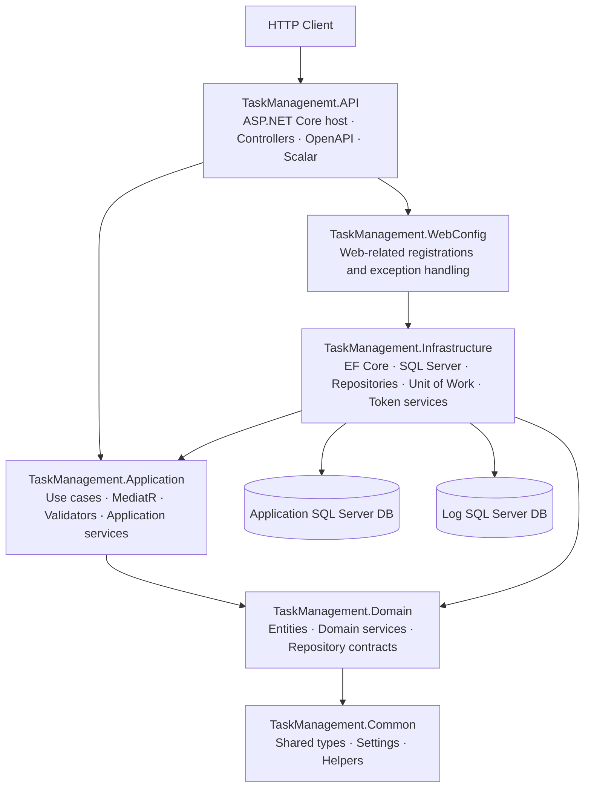
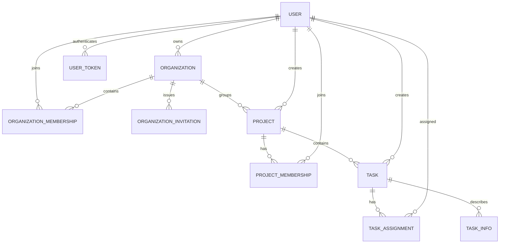
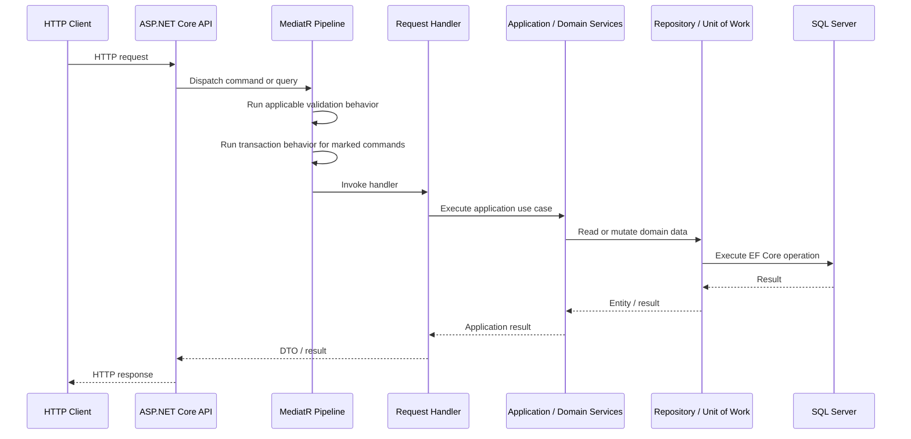

# TaskManagement API


A domain-oriented task and project management backend built with **ASP.NET Core on .NET 10**. The solution focuses on explicit domain rules, separated application and persistence concerns, MediatR-based use cases, validation pipelines, SQL Server persistence, transactional commands, and multi-device token lifecycle management.

> **Project status:** This repository is an actively developed backend project with production-minded architectural building blocks. The presence of an architecture pattern or security component does not, by itself, mean that the complete HTTP API is production-ready. See [Current implementation status](#current-implementation-status-and-production-readiness) before deploying it to a public environment.

---

## Contents

- [Overview](#overview)
- [Core capabilities](#core-capabilities)
- [Technology stack](#technology-stack)
- [Architecture](#architecture)
- [Solution structure](#solution-structure)
- [Domain model](#domain-model)
- [Authentication and token lifecycle](#authentication-and-token-lifecycle)
- [Persistence and data access](#persistence-and-data-access)
- [Getting started](#getting-started)
- [Configuration](#configuration)
- [Database migrations](#database-migrations)
- [API documentation](#api-documentation)
- [Request processing](#request-processing)
- [Development workflow](#development-workflow)
- [Production-hardening checklist](#production-hardening-checklist)
- [Current implementation status and production readiness](#current-implementation-status-and-production-readiness)
- [Troubleshooting](#troubleshooting)
- [Contributing](#contributing)
- [License](#license)

## Overview

TaskManagement API models collaborative work across users, organizations, projects, and tasks. An organization can contain members and projects; projects can maintain their own memberships and tasks; tasks can be assigned to users and extended with task-specific information.

The solution is organized as multiple .NET projects rather than a single API project. Domain behavior, application use cases, infrastructure implementations, shared utilities, and web configuration are separated so that each part has a clearer responsibility.

The current source includes application services for users, authentication, organizations, invitations, projects, tasks, and task information. It also includes a SQL Server persistence layer, dedicated log persistence, request validation, transaction behavior for marked commands, token generation and revocation logic, and OpenAPI/Scalar setup in the API host.

## Core capabilities

### Accounts and sessions

- Account data includes a mobile number, email address, password hash, security stamp, name, points, and last-login information.
- The mobile number is used as the login identifier by the authentication service.
- Passwords are hashed and verified with ASP.NET Core Identity's `PasswordHasher` implementation.
- Access tokens are signed and encrypted by the token service and carry device-related claims.
- Refresh tokens are generated using a cryptographically secure random number generator.
- Token records retain hashes rather than the original access and refresh token values.
- Validation paths are implemented for token validity, device binding, persisted token status, and security-stamp consistency. The token-hash comparison strategy needs the review described below before these paths can be relied on in production.
- The application contains operations for login, registration, refresh, logout, and revoking a device session or other active sessions.
- The domain service limits an account to **three active device/browser sessions** at a time.

### Organizations and membership

- Organizations have an owner, identifying code, description, active state, and member-capacity setting.
- Organization membership and invitations are modeled separately from the organization itself.
- Organization rules are expressed in domain entities and domain services rather than relying exclusively on HTTP controllers.
- Organization activity changes are represented explicitly in the domain model.

### Projects

- Projects belong to organizations and record their creator.
- Projects support membership, user/task capacity settings, progress, active state, and start/end timestamps.
- The project domain model includes lifecycle states such as `InProgress`, `Adjournment`, `Cancel`, and `Finished`.
- Project lifecycle methods contain guards for invalid or repeated state transitions.
- A `RowVersion` property is modeled for concurrency-aware persistence; verify its EF Core mapping before relying on optimistic concurrency in production.

### Tasks and assignments

- Tasks belong to projects and record their creator, type, status, deadline, active state, and progress.
- Task assignments are modeled separately, allowing a task to be associated with multiple users.
- `TaskInfo` provides a separate entity for additional task-related information.
- Task entities contain domain-level validation and lifecycle operations.
- A `RowVersion` property is modeled for concurrency-aware persistence; verify its EF Core mapping before relying on optimistic concurrency in production.

### Application behavior and validation

- CQRS-style command/query requests are handled through MediatR.
- FluentValidation validators are registered from the Application assembly.
- A validation pipeline behavior validates requests asynchronously before their handlers run.
- A transaction pipeline behavior is restricted to requests implementing `ITransactionalCommand`.
- Application services orchestrate use cases, while domain services encapsulate rules that span entities or rely on repository contracts.
- AutoMapper configuration is compiled and validated during application startup.
- `CancellationToken` is used across many asynchronous operations to support cooperative cancellation.

### Persistence and operational foundations

- SQL Server is used through Entity Framework Core.
- The application database and log database use separate `DbContext` types and connection-string settings.
- Repository implementations and Unit of Work abstractions are registered through infrastructure dependency injection.
- A custom Snowflake-style `long` ID generator encodes time, entity type, worker, sequence, and format version information.
- An EF Core save-changes interceptor normalizes Persian/Arabic character variants in changed string values.
- A separate log model includes entity-action and entity-relation records, backed by a dedicated log context and repository implementations.
- The API host registers centralized exception handling and exposes OpenAPI documents through Scalar.

## Technology stack

| Component | Current implementation |
|---|---|
| Language | C# |
| Runtime and framework | .NET 10 / ASP.NET Core |
| HTTP API | Controller-based ASP.NET Core setup |
| API description | ASP.NET Core OpenAPI and Scalar.AspNetCore |
| ORM and database provider | Entity Framework Core with SQL Server |
| Request dispatch | MediatR |
| Request validation | FluentValidation |
| Object mapping | AutoMapper |
| Password hashing | ASP.NET Core Identity `PasswordHasher` |
| Persistence patterns | Repository and Unit of Work |
| Data stores | Application SQL Server database and separate log SQL Server database |

The repository currently references the following package versions in its project files; these are the project's declared versions, not a claim that every package is the latest available release:

- `Microsoft.AspNetCore.OpenApi` — `10.0.12`
- `Microsoft.EntityFrameworkCore` / `Microsoft.EntityFrameworkCore.SqlServer` — `10.0.12`
- `MediatR` — `14.2.0`
- `FluentValidation` — `12.2.0`
- `AutoMapper` — `16.2.0`
- `Scalar.AspNetCore` — `2.17.14`

## Architecture

The solution uses a **layered architecture with Clean Architecture-inspired separation**. The project references are not a strict textbook implementation of Clean Architecture: for example, the WebConfig project references Infrastructure. The diagram below shows the main responsibilities and the typical request/data flow, not a guarantee that every HTTP endpoint is already wired end to end.



### Layer responsibilities

| Project | Responsibility |
|---|---|
| `TaskManagenemt.API` | Application entry point, ASP.NET Core host configuration, controller registration, OpenAPI document mapping, and Scalar API reference. The directory name contains the existing `Managenemt` spelling and is used as-is by the solution. |
| `TaskManagement.WebConfig` | Web-specific registration and exception-handling configuration kept outside the API entry point. |
| `TaskManagement.Application` | Use cases, command/query requests, handlers, request/response DTOs, application services, validation, mapping configuration, and MediatR pipeline behaviors. |
| `TaskManagement.Domain` | Domain entities, enums, domain exceptions, repository abstractions, and domain services. |
| `TaskManagement.Infrastructure` | EF Core contexts and configurations, SQL Server integration, repository implementations, Unit of Work implementations, token/password/ID helper services, and persistence interceptors. |
| `TaskManagement.Common` | Shared settings, helpers, and result/value types used across the solution. |

### Dependency injection

Registration is grouped by responsibility instead of accumulating all registrations in `Program.cs`:

- `RegisterAllApplicationLayerConfiguration()` registers application services, domain services, AutoMapper, MediatR, and FluentValidation.
- `RegisterAllInfrastructureLayerConfiguration(configuration)` registers both EF Core contexts, repositories, Unit of Work implementations, helper services, and strongly typed settings.
- `RegisterExceptionHandlersAndServices()` registers the web-level exception handling services.

This keeps the API bootstrap relatively small and makes registration logic easier to find and maintain.

## Solution structure

The following is a high-level map of the main projects and folders; it is intentionally representative rather than a complete file-by-file listing.

```text
TaskManagement-API/
├── TaskManagement.sln
├── TaskManagement.Common/
│   ├── Classes/
│   ├── Helpers/
│   └── Settings/
├── TaskManagement.Domain/
│   ├── Entities/
│   │   ├── BaseEntities/
│   │   └── LogEntities/
│   ├── Enums/
│   ├── Interface/
│   ├── Services/
│   └── Utilities/
├── TaskManagement.Application/
│   ├── DTOs/
│   │   ├── InternalDTOs/
│   │   ├── RequestDTOs/
│   │   └── ResponseDTOs/
│   ├── Features/
│   ├── Interfaces/
│   ├── Pipelines/
│   ├── Services/
│   └── Utilities/
├── TaskManagement.Infrastructure/
│   ├── Persistence/
│   │   ├── Configurations/
│   │   ├── DbContexts/
│   │   └── Interceptors/
│   ├── QueryCache/
│   ├── Repositories/
│   ├── Services/
│   ├── UnitOfWorks/
│   └── Utilities/
├── TaskManagement.WebConfig/
├── TaskManagenemt.API/
│   └── Program.cs
└── README.md
```

## Domain model

The core application model is built around the following entities and relationships:



| Entity | Purpose |
|---|---|
| `User` | Account and profile data, credential hash, security stamp, points, login information, and navigation to organizations, projects, tasks, and sessions. |
| `UserToken` | Persisted device/session information, access/refresh token hashes, lifecycle status, expiry data, and security-stamp information. |
| `Organization` | Organization identity, owner, activation state, capacity, invitations, memberships, and projects. |
| `OrganizationMemberShip` | Association between a user and an organization. |
| `OrganizationInvitation` | Invitation data associated with an organization and user workflow. |
| `Project` | Project details, parent organization, creator, lifecycle status, progress, capacity settings, and members/tasks. |
| `ProjectMemberShip` | Association between a user and a project. |
| `Task` | Work item details, project/creator references, status/type, deadline, progress, and assignments. |
| `TaskAssignment` | Association between task work and assigned users. |
| `TaskInfo` | Additional information associated with a task. |
| `EntityLog` | Entity-level action log record. |
| `EntityRelationLog` | Log record for an action involving a relationship between entities. |

Most application entities derive from `BaseEntity`, which provides an ID, deletion flag, creation timestamp, optional update timestamp, and a domain-level soft-delete method. The existence of the `IsDelete` property does **not** automatically prove that every query excludes deleted rows; verify global query filters and deletion flows before relying on soft-delete isolation.

## Authentication and token lifecycle

Authentication-related application logic is implemented as a combination of application services, domain rules, and infrastructure token services.

### Token design

- **Access tokens:** generated as signed and encrypted tokens, using HMAC-SHA256 signing and AES-based token encryption in the current implementation.
- **Refresh tokens:** generated from cryptographically secure random bytes and rotated through the refresh workflow.
- **Token persistence:** access and refresh values are hashed before being stored in the `UserToken` entity.
- **Device binding:** access-token validation checks the device ID claim against the supplied device ID.
- **Session validation:** application-level validation checks the persisted token hash, active/revoked status, and security stamp.
- **Session management:** the application contains operations to revoke the current device's token, revoke all active tokens, or revoke sessions other than the current device.
- **Concurrent sessions:** the domain service rejects another login when three active sessions already exist.

### Important integration note

Token generation and validation services are not the same thing as ASP.NET Core's HTTP authentication middleware. In the currently reviewed `Program.cs`, controller authorization is added with `UseAuthorization()`, but an explicit `AddAuthentication(...)` scheme and `UseAuthentication()` are not shown. Before exposing protected routes, configure and test the complete authentication/authorization pipeline, including how the device ID is supplied and validated. Do not assume that a generated bearer token automatically protects controller actions.

**Token-hash verification also needs a code-level fix or explicit verification.** The current `AuthService` paths call the password service to hash an access/refresh token and then compare the newly generated hash string to the stored value. The password service uses ASP.NET Core Identity `PasswordHasher`, which uses a random salt; hashing the same input again normally produces a different encoded hash. Direct string equality against a freshly generated hash is therefore not a valid verification pattern and can make session/refresh validation fail. Use a deterministic cryptographic digest (for example, SHA-256 or a keyed HMAC for high-entropy token values) for lookup, or retrieve the stored value and verify it using the hasher's verification API. Add tests for login, access-token validation, refresh rotation, and revocation after changing this logic.

### Secret handling

The signing secret and encryption key are required configuration values. Use unique, securely generated values in each environment, keep them out of source control, and plan how they will be rotated. Do not use sample or development keys in a public deployment.

## Persistence and data access

### Two database contexts

Infrastructure registers two SQL Server contexts:

| Context | Connection string key | Purpose |
|---|---|---|
| `ApplicationDbContext` | `ConnectionStrings:ApplicationConnectionString` | Main business entities and application data. |
| `LogDbContext` | `ConnectionStrings:ApplicationLogConnectionString` | Entity and entity-relation log records. |

The contexts are separate, which allows application data and operational/business logs to be stored independently. If the application requires atomic consistency between business writes and log writes, design that explicitly; transactions in one context do not automatically create a distributed transaction across both databases.

### Repository and Unit of Work

- Repository contracts are defined outside their infrastructure implementations.
- `BaseRepository<TEntity>` provides asynchronous query and command operations, including filtered queries, existence/count checks, field projections, attach/detach operations, and explicit loading.
- Read methods can use `AsNoTracking` where entity tracking is unnecessary.
- Compiled EF Core queries are used by the base repository for common ID lookups.
- `UnitOfWork` groups repositories around `ApplicationDbContext` and exposes save and transaction operations.
- `ITransactionalCommand` marks requests that should be executed inside the configured transaction pipeline.

### EF Core conventions and interceptors

`ApplicationDbContext` scans the Domain and Infrastructure assemblies for entity types and entity configurations. It also applies conventions for generated IDs, restricted delete behavior, and pluralized table names.

Two save-changes interceptors are registered for the application context:

1. `NormalizeStringInterceptor` normalizes Persian/Arabic character forms in changed string properties before persistence.
2. `EntityIdSaveChangesInterceptor` provides a fallback for assigning a generated ID to new entities that still have an unassigned ID.

### Custom ID generation

The `IdGeneratorService` implements a custom Snowflake-style 64-bit ID layout. Its fields encode timestamp, entity type, worker ID, sequence, and an ID-format version. The configured `WorkerId` must be in the range **0–7** and must be unique among concurrently running nodes that share the same ID space. Clock synchronization and multi-instance behavior should be tested under the deployment environment before horizontal scaling.

### Business and relation logs

The solution contains separate log entities and repository implementations for entity actions and entity relations. Treat these as the persistence foundation for audit records, not as proof that every business operation is automatically audited. Before relying on logs for compliance or incident investigation, verify that all required use cases emit the correct actor, entity, action, timestamp, and correlation information.

## Getting started

### Prerequisites

- [.NET 10 SDK](https://dotnet.microsoft.com/download/dotnet/10.0)
- A reachable SQL Server instance
- A SQL Server login or Windows identity with permission to create/update the application and log databases
- Git
- An IDE such as Visual Studio 2026 or a compatible editor (optional)

Confirm the installed SDK:

```bash
dotnet --info
```

### 1. Clone the repository

```bash
git clone https://github.com/CallMeMazi/TaskManagement-API.git
cd TaskManagement-API
```

### 2. Restore and build

```bash
dotnet restore TaskManagement.sln
dotnet build TaskManagement.sln
```

Resolve any local SDK or configuration issues reported by the build before continuing.

### 3. Configure local settings

Create a development settings file at:

```text
TaskManagenemt.API/appsettings.Development.json
```

Use the [Configuration](#configuration) section as a starting point. This file should contain local connection strings and development-only secrets; do not commit real credentials.

### 4. Prepare the databases

Configure separate connection strings for the application database and log database. Apply the EF Core migrations for `ApplicationDbContext` and `LogDbContext` as described under [Database migrations](#database-migrations).

The current startup code does not explicitly call `EnsureCreated()`. Do not assume that the schema is created automatically when the application starts.

### 5. Run the API host

```bash
dotnet run --project TaskManagenemt.API/TaskManagenemt.API.csproj
```

Use the actual URL and port printed by ASP.NET Core. In Development, the port is usually determined by the launch profile or local hosting configuration.

### 6. Open the API reference

When the host is running, open Scalar at:

```text
https://localhost:<port>/scalar/v1
```

The raw OpenAPI document is available at:

```text
https://localhost:<port>/openapi/v1.json
```

Replace `<port>` with the port reported by the application. If HTTPS development certificates are not trusted, run `dotnet dev-certs https --trust` on a supported development machine.

## Configuration

The infrastructure registration reads the following configuration keys:

- `ConnectionStrings:ApplicationConnectionString`
- `ConnectionStrings:ApplicationLogConnectionString`
- `AppSettings:JwtSetting`
- `AppSettings:UserSetting`
- `AppSettings:IdGeneratorSetting`

### Example development configuration

The following is a template. Replace all secrets and connection values before running it. The SQL Server connection strings use Windows authentication as an example; adapt them to your local SQL Server configuration.

```json
{
  "ConnectionStrings": {
    "ApplicationConnectionString": "Server=localhost;Database=TaskManagementDb;Trusted_Connection=True;TrustServerCertificate=True;",
    "ApplicationLogConnectionString": "Server=localhost;Database=TaskManagementLogDb;Trusted_Connection=True;TrustServerCertificate=True;"
  },
  "AppSettings": {
    "JwtSetting": {
      "SecretKey": "REPLACE_WITH_BASE64_ENCODED_RANDOM_KEY",
      "Encryptkey": "REPLACE-WITH-16B",
      "Issuer": "TaskManagement.Api",
      "Audience": "TaskManagement.Client",
      "NotBeforeMinutes": 0,
      "ExpirationMinutesAccessToken": 15,
      "ExpirationDaysRefreshToken": 7
    },
    "UserSetting": {
      "PositiveUserPoints": 1,
      "NegativeUserPoints": 1
    },
    "IdGeneratorSetting": {
      "WorkerId": 1
    }
  }
}
```

**Key requirements:**

- `JwtSetting:SecretKey` is passed through `Convert.FromBase64String`, so it must be a valid Base64-encoded key.
- `JwtSetting:Encryptkey` is converted to UTF-8 bytes and is used with AES-128 key wrapping; configure a proper 16-byte key for that algorithm. The string in the example is a placeholder, not a secure production key.
- `Issuer`, `Audience`, access-token lifetime, refresh-token lifetime, and not-before settings must agree with the deployment's token policy.
- `IdGeneratorSetting:WorkerId` must be between `0` and `7`. Use a distinct value for each concurrently active node sharing the ID namespace.
- The `PositiveUserPoints` and `NegativeUserPoints` values are application settings. Choose values based on the intended business rules.

For the signing secret, one option is to generate random bytes and encode them as Base64:

```bash
openssl rand -base64 32
```

Use a separate cryptographically random value for the encryption key, ensuring the byte length required by the configured algorithm. Do not reuse a human-readable example value.

### Store secrets outside source control

For local development, prefer ASP.NET Core User Secrets or environment variables instead of committing passwords and cryptographic keys to `appsettings.json`.

Example User Secrets commands (run from the repository root):

```bash
dotnet user-secrets init --project TaskManagenemt.API/TaskManagenemt.API.csproj
dotnet user-secrets set "ConnectionStrings:ApplicationConnectionString" "<application-connection-string>" --project TaskManagenemt.API/TaskManagenemt.API.csproj
dotnet user-secrets set "ConnectionStrings:ApplicationLogConnectionString" "<log-connection-string>" --project TaskManagenemt.API/TaskManagenemt.API.csproj
dotnet user-secrets set "AppSettings:JwtSetting:SecretKey" "<base64-signing-key>" --project TaskManagenemt.API/TaskManagenemt.API.csproj
dotnet user-secrets set "AppSettings:JwtSetting:Encryptkey" "<16-byte-encryption-key>" --project TaskManagenemt.API/TaskManagenemt.API.csproj
```

ASP.NET Core configuration providers support environment-variable names using double underscores in place of colons, for example `AppSettings__JwtSetting__Issuer`.

## Database migrations

The infrastructure project contains both `ApplicationDbContext` and `LogDbContext`. Check the repository for existing migrations before creating new ones. If migrations already exist, apply them; do not create a duplicate initial migration.

### Install or update EF Core CLI tooling

The EF Core tool version should match the EF Core packages used by the project:

```bash
dotnet tool update --global dotnet-ef --version 10.0.12
```

If `dotnet-ef` is not installed, use `dotnet tool install --global dotnet-ef --version 10.0.12` instead.

### Inspect existing migrations

```bash
dotnet ef migrations list --project TaskManagement.Infrastructure/TaskManagement.Infrastructure.csproj --startup-project TaskManagenemt.API/TaskManagenemt.API.csproj --context ApplicationDbContext

dotnet ef migrations list --project TaskManagement.Infrastructure/TaskManagement.Infrastructure.csproj --startup-project TaskManagenemt.API/TaskManagenemt.API.csproj --context LogDbContext
```

### Create migrations only when needed

If no migrations are tracked for a context, create its initial migration with the corresponding command:

```bash
dotnet ef migrations add InitialApplicationSchema --project TaskManagement.Infrastructure/TaskManagement.Infrastructure.csproj --startup-project TaskManagenemt.API/TaskManagenemt.API.csproj --context ApplicationDbContext --output-dir Persistence/Migrations/Application

dotnet ef migrations add InitialLogSchema --project TaskManagement.Infrastructure/TaskManagement.Infrastructure.csproj --startup-project TaskManagenemt.API/TaskManagenemt.API.csproj --context LogDbContext --output-dir Persistence/Migrations/Logs
```

Review generated migrations before applying them to any database with data.

### Apply migrations

```bash
dotnet ef database update --project TaskManagement.Infrastructure/TaskManagement.Infrastructure.csproj --startup-project TaskManagenemt.API/TaskManagenemt.API.csproj --context ApplicationDbContext

dotnet ef database update --project TaskManagement.Infrastructure/TaskManagement.Infrastructure.csproj --startup-project TaskManagenemt.API/TaskManagenemt.API.csproj --context LogDbContext
```

The API project must be able to load the required configuration during EF tooling startup. If design-time creation fails, verify both connection strings, required `AppSettings`, startup-project selection, and the installed SDK/tool versions.

## API documentation

The API host uses the built-in ASP.NET Core OpenAPI registration and Scalar API Reference. With the application running:

- **Scalar UI:** `/scalar/v1`
- **OpenAPI JSON:** `/openapi/v1.json`

The OpenAPI document is the canonical machine-readable API contract. Keep endpoint summaries, response types, validation behavior, authorization requirements, and examples aligned with the actual controller routes. The feature list in this README describes domain/application capabilities and should not be interpreted as a promise that every capability already has a completed public HTTP endpoint.

When adding an endpoint, document at least:

1. HTTP method and route.
2. Authentication and authorization policy.
3. Request schema and validation rules.
4. Success status code and response schema.
5. Expected error statuses and error body format.
6. Pagination, filtering, sorting, and concurrency behavior, when applicable.

## Request processing

For a completed controller endpoint, the intended separation of responsibilities is:



Not every request uses a transaction: `TransactionBehavior` is constrained to `ITransactionalCommand`. Queries and commands that do not implement that marker should not be assumed to execute inside this transaction behavior.

## Development workflow

### Build after changes

```bash
dotnet restore TaskManagement.sln
dotnet build TaskManagement.sln --no-restore
```

### Validate mappings

AutoMapper mappings are compiled and checked through `CompileAutoMapperConfiguration()` during host startup. A mapping configuration failure should be treated as a startup defect and fixed rather than bypassed.

### Add a new use case

A typical use-case change should keep responsibilities separated:

1. Model invariants in a domain entity or domain service where appropriate.
2. Define the application request and response DTOs.
3. Add a MediatR handler to orchestrate the use case.
4. Add a FluentValidation validator for request-shape and input constraints.
5. Use repository contracts and Unit of Work abstractions rather than directly creating EF Core contexts in application handlers.
6. Implement persistence details only in Infrastructure.
7. Mark a command with `ITransactionalCommand` when the complete operation needs the configured transaction behavior.
8. Add or update the HTTP endpoint and OpenAPI metadata when the presentation layer exposes the use case.
9. Add automated tests before considering the behavior complete for production.

### Cancellation

Pass the incoming `CancellationToken` through asynchronous database calls and downstream service methods. Avoid suppressing cancellation unless there is a deliberate reason to finish an operation after the caller disconnects.

## Production-hardening checklist

Before a public or business-critical deployment, review the following areas in the context of the target environment.

### Security

- [ ] Register an explicit ASP.NET Core authentication scheme and the appropriate authentication middleware.
- [ ] Apply authorization policies to protected controller actions and test unauthenticated and unauthorized responses.
- [ ] Fix token-hash verification before relying on it: do not compare two independently generated ASP.NET Identity password-hash strings; use a deterministic token digest or the hasher verification API.
- [ ] Confirm token validation, device binding, persisted token status, refresh rotation, revocation, and security-stamp behavior end to end with automated tests.
- [ ] Store signing keys, encryption keys, and database credentials in a managed secret store or equivalent protected configuration system.
- [ ] Configure HTTPS, trusted proxy behavior, CORS, request-size limits, and security headers for the actual deployment topology.
- [ ] Define rate limits for login, registration, refresh, and other abuse-prone routes.
- [ ] Avoid logging passwords, bearer tokens, refresh tokens, secret values, or other sensitive request data.

### Reliability and data correctness

- [ ] Verify migrations and schema creation for both database contexts.
- [ ] Add automated unit, integration, and API tests for critical workflows and authorization boundaries.
- [ ] Verify unique constraints and indexes for identifiers that must be unique.
- [ ] Verify `RowVersion` mapping and conflict handling before relying on optimistic concurrency.
- [ ] Confirm soft-delete query behavior and all dependent-entity lifecycle rules.
- [ ] Decide whether business changes and audit events require atomic persistence, an outbox, or another consistency strategy.
- [ ] Use UTC consistently for persisted and token-related timestamps; review local-time usage in current entity and ID-generation code.
- [ ] Test the custom ID generator under clock changes, sequence rollover, and multiple application instances with unique worker IDs.

### Operations

- [ ] Add structured application logging, correlation/trace IDs, and a defined policy for sensitive fields.
- [ ] Complete slow-request logging/metrics in the performance behavior or move telemetry to a dedicated observability mechanism.
- [ ] Add health and readiness checks for the API and its critical dependencies.
- [ ] Add Docker/deployment artifacts and a CI pipeline if they are required by the target hosting platform.
- [ ] Define backup, restore, migration rollback, retention, and disaster-recovery procedures for both databases.
- [ ] Load-test data-intensive endpoints and review execution plans and indexes against realistic workloads.
- [ ] Establish a supported package update process and dependency/security scanning.

## Current implementation status and production readiness

The following distinctions are intentional so the documentation does not overstate the repository's current scope.

| Area | Status in the reviewed source snapshot |
|---|---|
| .NET 10 multi-project solution | Present |
| Application/domain services for users, authentication, organizations, invitations, projects, tasks, and task information | Present |
| MediatR request dispatch, FluentValidation registration, validation behavior, transactional-command behavior | Present |
| AutoMapper registration and startup mapping validation | Present |
| EF Core SQL Server persistence, repositories, Unit of Work, and two DbContexts | Present |
| Access/refresh token service, device checks, token hashing, session revocation methods | Present in application/infrastructure code; token-hash verification requires review/fix and HTTP authentication middleware needs end-to-end verification |
| OpenAPI and Scalar host registration | Present |
| Automated test suite | Not included in the reviewed repository structure |
| Docker / Docker Compose deployment setup | Not included in the reviewed repository structure |
| Redis caching | Not included |
| CI/CD workflow | Not included in the reviewed repository structure |
| Complete request-level security, rate limiting, health checks, and production observability | Must be implemented and/or verified before production use |
| Automatic audit emission for every business operation | Log entities and repositories exist; complete event coverage must be verified |

The `PerformanceBehavior` currently measures request duration, but its slow-request logging block is a placeholder. It should not be described as complete performance monitoring until it emits useful telemetry.

## Troubleshooting

### The application cannot connect to SQL Server

- Verify that the SQL Server instance is running and reachable from the API process.
- Check both `ApplicationConnectionString` and `ApplicationLogConnectionString`.
- Confirm the credentials or Windows identity used by the process have the required database permissions.
- Check that encryption and certificate settings are appropriate for the local or production environment.

### EF Core tooling cannot create a context

- Run the EF commands from the repository root.
- Use `TaskManagement.Infrastructure` as the migrations project and `TaskManagenemt.API` as the startup project.
- Verify both connection strings and required `AppSettings` are available to the startup process.
- Ensure the `dotnet-ef` major/minor version matches the EF Core package version.

### JWT creation fails while reading configuration

- `SecretKey` must be valid Base64 because the implementation decodes it before creating signing credentials.
- `Encryptkey` must have the byte length expected by AES-128 key wrapping.
- Verify that `Issuer`, `Audience`, and token lifetime settings are present and correctly loaded.
- Do not copy the placeholder values from the documentation into a real environment.

### A generated token does not authorize a request

Generating a token does not configure the ASP.NET Core authentication middleware. Verify that a bearer authentication scheme is registered, authentication middleware executes before authorization middleware, and controller policies match the token-validation requirements.

### Scalar does not show the expected operations

- Confirm the API host started successfully.
- Open `/openapi/v1.json` and inspect the generated document.
- Check that the relevant controller is compiled into the API project, its route attributes are correct, and the endpoint is discoverable by ASP.NET Core OpenAPI.

## Contributing

Contributions should preserve the separation between domain rules, application use cases, and infrastructure concerns. For a meaningful change, include a concise description of the behavior, the affected layer(s), any database migration, relevant validation/error behavior, and tests when available.

Suggested branch naming:

```text
feature/<short-description>
fix/<short-description>
refactor/<short-description>
```

Before opening a pull request, restore dependencies and run the solution build. If the change affects persistence, review the generated migration; if it affects authorization or token workflows, cover both expected and denied paths with tests.

## License

No license file was present in the reviewed repository root. Until a license is added, reuse and redistribution permissions are not explicitly granted by this repository. Add a `LICENSE` file if the project is intended for public reuse.
